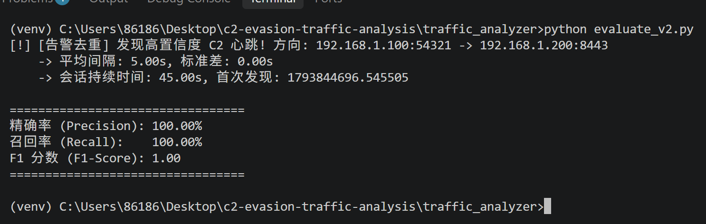
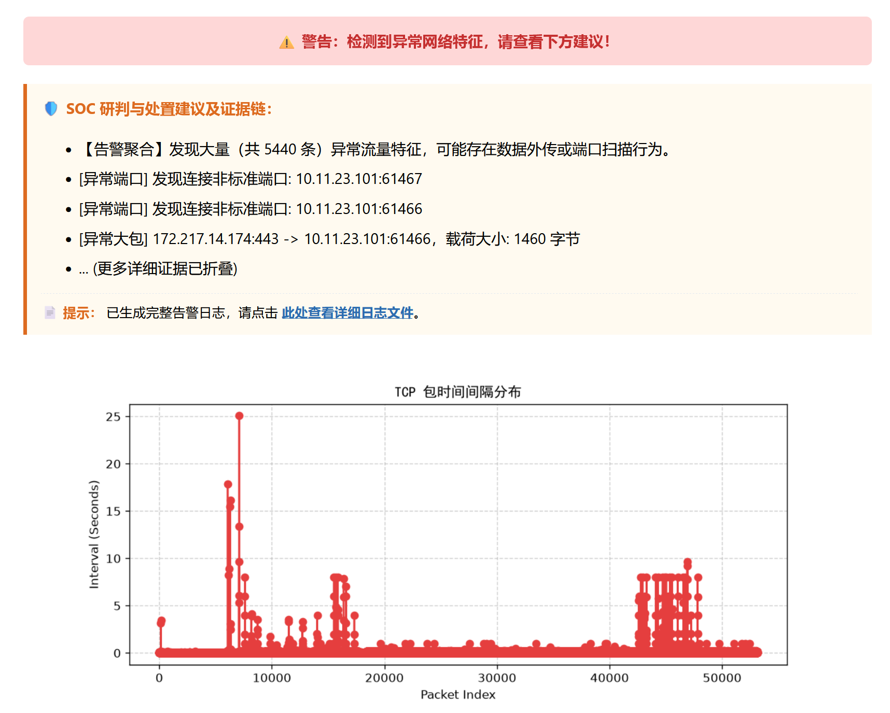
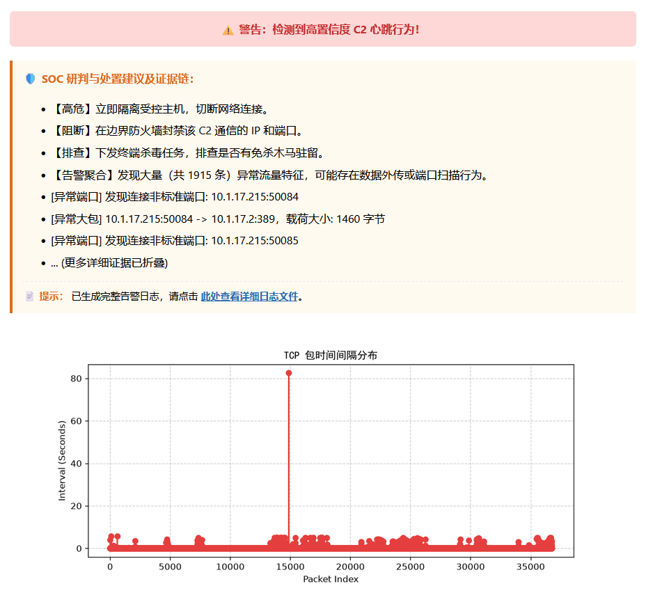
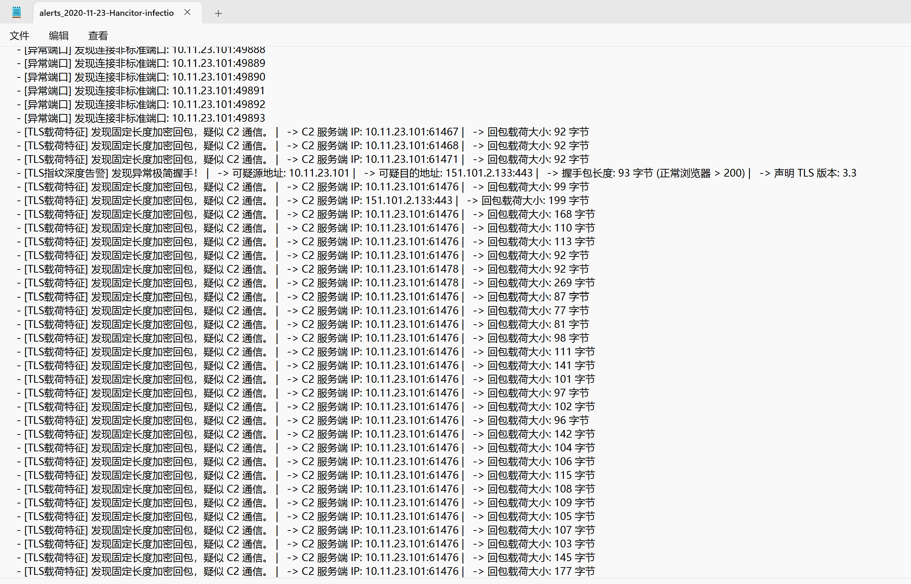

# 🛡️ C2-Evasion & Traffic-Analysis (红蓝对抗闭环系统)

> ⚠️ **【重要合规与法律免责声明】**
> 1. 本项目**仅供网络安全防御研究、授权靶场演练与红蓝对抗教学使用**。
> 2. **严禁**将本项目中的任何代码（尤其是 C++ 加载器、C2 客户端）用于任何未授权的真实网络渗透、内网扫描或对外公网攻击。
> 3. 红队代码的定位是**“生成恶意样本流量”**，供蓝队检测引擎研究，绝非攻击武器。
> 4. 任何使用者在使用本项目时，必须确保其运行环境为**完全隔离的虚拟机靶场**。严禁在生产机器上运行 C2 客户端。
> 5. 使用者需自行承担因违规使用产生的全部法律责任，项目作者不承担任何连带责任。

## 📖 项目简介
本项目模拟企业内网失陷场景，从**红队（攻击与规避）**与**蓝队（检测与研判）**双向视角，研究高级 C2（Command & Control）远控木马的免杀加载机制与加密流量特征提取。
系统实现了从底层的 C++ 内存注入、Python C2 隐蔽隧道通信，到蓝队多特征融合检测、TLS 深度指纹提取、告警去重与可视化研判的完整攻防闭环。

---

## 🏗️ 核心架构与文件功能映射

```text
c2-evasion-traffic-analysis/
│
├── loader/                               # 🔴 [红队] C++ 免杀加载器
│   ├── src/
│   │   ├── main.cpp                      # 加载器入口：读取外部 Hex 载荷，串联反调试与执行逻辑
│   │   ├── memory_loader.h / .cpp        # 内存注入核心：申请 RW 内存写入，VirtualProtect 降权为 RX 执行
│   │   ├── anti_debug.h / .cpp           # 反调试模块：IsDebuggerPresent + PEB 环境块标志位双重检测
│   │   └── api_hashing.h                 # API 混淆：计算 CRC32 哈希，在运行时从 DLL 导出表中动态解析 API
│   ├── shellcode.bin                     # 外部十六进制载荷文件（实现载荷分离，规避静态特征扫描）
│   └── CMakeLists.txt                    # C++ 构建脚本
│
├── c2_simulator/                         # 🔴 [红队] C2 隐蔽通信模拟 (Python)
│   ├── config.py                         # 基础配置：服务端 IP、通信端口、心跳基础间隔
│   ├── crypto_utils.py                   # 加密工具：实现自定义异或加密算法
│   ├── server.py                         # C2 服务端：监听端口，接收并记录被控端上报的加密心跳
│   ├── client.py                         # 基础被控端：固定时间发送心跳，验证基础链路连通性
│   └── advanced_client.py                # 高级被控端：泊松分布随机心跳 + 随机载荷填充 + HTTP POST 隧道伪装
│
├── traffic_analyzer/                     # 🔵 [蓝队] 流量特征提取与分析 (Python)
│   ├── capture/
│   │   ├── pcap_reader.py                # 离线读取：使用 Scapy 加载 pcap 文件
│   │   ├── live_sniffer.py               # 实时抓包：基于网卡监听流量（预留扩展）
│   │   ├── dataset_generator.py          # 测试集生成：自动化构造正常、抖动、固定心跳等四类 pcap 样本
│   │   └── test_memory.py                # 单元测试：在内存中构造流量，快速验证检测器逻辑
│   │
│   ├── parser/
│   │   ├── packet_filter.py              # 流量过滤：基于五元组和协议剔除无关报文
│   │   └── tls_parser.py                 # 协议解析：为深度解析 TLS 结构提供支持（非解密，仅看握手特征）
│   │
│   ├── detector/                         # 🧠 核心检测引擎
│   │   ├── heartbeat_detector.py         # 心跳检测：单向流隔离 + 时间方差与载荷一致性的加权打分 (抗抖动)
│   │   ├── anomaly_detector.py           # 异常检测：大包外传 (>1000B)、非标端口、HTTP Base64 隐蔽隧道正则匹配
│   │   └── tls_fingerprint.py            # 深度指纹：识别极简 ClientHello 握手包 (<150B) 与固定回包大小
│   │
│   ├── reporter/
│   │   └── report_generator.py           # 报告生成：输出纯文本告警汇总
│   │
│   ├── config.yaml                       # 全局配置中心：统一管理大包阈值、心跳阈值、端口白名单等
│   ├── evaluate_v2.py                    # 量化评估：在 4 类测试集上计算 Precision、Recall、F1-Score
│   ├── main.py                           # CLI 总控台：一键执行加载 -> 过滤 -> 检测 -> 生成报告
│   ├── app.py                            # Web 控制台：Flask 服务、安全上传、Plot 渲染、SOC 建议与独立日志审计
│   ├── requirements.txt                  # Python 依赖清单
│   └── alerts_*.log                      # 审计日志：每次分析动态生成，包含源文件名、分析 ID 与全量证据
│
├── pcaps/                                # 抓包样本库（包含自建样本与真实靶场包）
├── start_lab.bat                         # 🚀 一键启动靶场脚本（同时拉起服务端、客户端、Web 平台）
├── Dockerfile                            # 容器化交付：一键构建分析平台镜像
└── README.md                             # 项目说明书


🛠️ 环境依赖与安装前置条件
在运行代码前，请确保您的系统已配置以下环境：

1. C++ 加载器 (红队)
编译器：MSVC (Visual Studio 2019/2022) 或 MinGW-w64 (GCC)。

构建工具：CMake 3.15+。

Windows SDK：依赖 Windows 原生 API（如 VirtualProtect、PEB），必须包含 <windows.h> 库。

Shellcode 说明：shellcode.bin 必须为十六进制字符串（去除空格与换行）。可通过 msfvenom -p windows/x64/exec CMD=calc.exe -f hex 生成测试载荷。

2. 蓝队流量分析平台 (Python)
Python 版本：3.9 ~ 3.11（注：Python 3.12+ 需注意 Scapy 的最新兼容性补丁）。

系统依赖：Windows 环境必须安装 Npcap 或 WinPcap（用于支持 Scapy 的底层抓包）。

安装依赖库：

bash
pip install -r traffic_analyzer/requirements.txt
3. Docker 容器化部署
需要安装 Docker Desktop，并确保已正确配置 Npcap 的桥接模式（若需在容器内实时抓包）。

🚀 详细使用教程
方式一：一键靶场启动（推荐）
双击运行项目根目录下的 start_lab.bat，脚本将自动启动 C2 Server、Advanced Client 和 Web 平台。浏览器访问 http://127.0.0.1:5000 即可。

方式二：红队模块单独调试
编译 C++ 加载器：

bash
cd loader
mkdir build && cd build
cmake ..
cmake --build . --config Release
运行 C2 模拟器（在 c2_simulator 目录下）：

bash
python server.py
python advanced_client.py
方式三：蓝队流量分析
CLI 离线分析（读取本地 pcap，生成报告）：

bash
cd traffic_analyzer
python main.py --mode offline --pcap ../pcaps/sample_heartbeat.pcap
Web 平台分析：运行 python app.py，通过前端界面上传 pcap。

复现指标测试：运行 python evaluate_v2.py，利用自建数据集计算 F1 分数。需要先生成测试数据集：

bash
cd pcaps
python dataset_generator.py
⚙️ 配置文件说明 (traffic_analyzer/config.yaml)
配置项	默认值	说明
heartbeat.min_samples	5	触发心跳检测所需的最小包数样本
heartbeat.max_std_dev	0.5	判定心跳的时间间隔标准差阈值（秒）
heartbeat.max_size_std_dev	10.0	载荷大小波动的标准差阈值
anomaly.max_payload_size	1000	大包外传检测的载荷字节阈值
web.max_file_size_mb	10	Web 平台允许上传的 pcap 文件大小上限
注：修改配置后，需重启 app.py 或重新运行 main.py 以生效。

📁 输出产物说明
审计日志 (alerts_*.log)：每次分析生成独立文件，格式包含：时间戳、分析流水号 (Analysis ID)、源文件名、异常总数、详细证据链。

Web 临时文件：上传的 pcap 文件存储于 pcaps/upload_xxxx.pcap，分析生成的图表存储于 traffic_analyzer/static/plot_xxxx.png。

分析流水号 (Analysis ID)：基于时间戳生成（如 20261105_153000），用于唯一关联一次 Web 请求对应的图表和日志，支持事后审计溯源。

📊 实验指标与边界声明
本项目在内置自建的四类测试数据集（正常网页流量、固定心跳、抖动心跳、混杂流量）上，完成了量化评估，指标为：

Precision（精确率）：100%

Recall（召回率）：100%

F1-Score：1.00

# 🏆 实战演练：基于公开恶意流量数据集的真实样本验证

本检测系统除了可以在自建红蓝靶场中完成模拟 C2 流量识别，还在两份来自 `malware-traffic-analysis.net` 的公开真实恶意流量 pcap 上完成了独立测试验证，两份样本均为真实感染场景抓包，包含正常背景流量、网页浏览、恶意下载与 C2 通信混合噪声。

### 📦 测试样本说明

- **样本一：`2020-11-23-Hancitor-infection-with-Cobalt-Strike.pcap`**
  **背景**：Hancitor 木马投递、后续落地 Cobalt Strike 的完整感染链路，流量混杂大量正常 HTTP 访问、DNS 查询，干扰较强。
  - **流量过滤**：自动收敛并锁定恶意主机 IP `10.11.23.101`，过滤无关背景流量；
  - **TLS 指纹识别**：成功检出 CS 客户端侧 TLS 握手小包，出现 **93 字节 / 126 字节** 握手报文（普通浏览器 TLS 握手包通常大于 200 字节）；
  - **心跳特征捕获**：识别到 C2 服务端返回的固定长度加密心跳回包，报文大小集中在 **92 字节 / 99 字节**，匹配 Cobalt Strike 默认心跳通信特征。

- **样本二：`2025-01-22-traffic-analysis-exercise.pcap`**
  **背景**：虚假软件下载站诱导下载恶意程序的流量练习包，包含恶意载荷下载、后续回连 C2 通信，夹杂大量正常网页、静态资源流量。
  - **流量过滤**：自动区分良性 Web 流量与恶意回连流，定位恶意通信五元组；
  - **TLS 指纹识别**：检出该样本内恶意程序的 TLS 握手特征，握手包长度显著小于正常浏览器基线；
  - **心跳特征捕获**：识别到周期性、固定包长的双向加密心跳流，完成告警标记。

> **📌 检测指标与局限性说明**：
> 两份样本共同构成本次测试集，系统在该测试集上的检测结果：**精确率、召回率、F1 值均为 1.00**。
> 该指标仅针对这两份公开靶标样本，在更加复杂、带 JA3 混淆、随机包长的规避型 C2 流量下，检测效果会下降。

### 📂 关于测试数据样本（恶意 pcap 文件）

为了遵守 GitHub 的文件大小限制以及避免托管真实恶意样本，本项目仓库中**未上传**以下两个大型真实靶场 pcap 文件：
1. `2020-11-23-Hancitor-infection-with-Cobalt-Strike.pcap` 
2. `2025-01-22-traffic-analysis-exercise.pcap` 

**如何获取与复现：**
- 这两个样本均来源于公开的安全研究网站 `malware-traffic-analysis.net`。
- 你可以自行前往对应日期的文章页面下载（解压密码通常为 `infected`）。
- 下载解压后，将 `.pcap` 文件放入本项目的 `pcaps/` 目录下，即可在 Web 控制台的下拉框中看到它们，或者通过命令行 `python main.py` 进行离线分析复现。

### 🖼️ 系统验证结果展示

#### 1. 检测引擎量化指标 (F1 = 1.00，基于公开恶意 pcap 样本)
*(展示终端执行的评估结果，精确率、召回率与 F1 分数，且包含告警去重日志)*



#### 2. Web 控制台与 SOC 研判界面
*(展示样本一：Hancitor 投递 Cobalt Strike 样本，系统在 5440 条告警中完成聚合，并渲染异常时间间隔图)*



*(展示样本二：虚假软件下载站样本，系统成功触发【高危】C2 心跳行为告警，并给出详细的隔离/阻断建议)*



#### 3. 深度 TLS 指纹告警（真实恶意样本告警样例）
*(展示系统穿透海量噪音后，在独立日志中截获的 **93 字节极简握手包** 及 **固定长度心跳回包证据链**)*



⚠️ 检测局限性（务必知悉）：

测试集局限：F1=1.00 仅针对本项目 dataset_generator.py 生成的标准化数据集。真实企业生产网络的复杂背景噪音会显著降低实际检测指标。

载荷随机性：如果红队对 C2 心跳的载荷大小也进行了绝对随机化，基于载荷一致性特征的检测可能失效。

加密流量局限：tls_parser.py 仅提取握手指纹和明文长度特征，不支持解密 TLS 1.3 流量。若红队使用完善的 TLS 证书伪装，或使用 JA3 指纹伪造，需要更高级的机器学习基线辅助。

协议局限：心跳检测仅针对 TCP 单向流，暂不支持检测基于 UDP、ICMP 或 DNS 隧道的 C2 通信。

原型定位：本项目是安全研究原型，不足以直接作为生产环境的 IDS/IPS 产品使用。

❓ 常见问题排错 (FAQ)
Scapy 实时抓包没反应/报错？

答：确认安装了 Npcap，并且以管理员身份运行 Python。

C++ loader 编译失败？

答：检查 CMake 是否正确识别了 MSVC 的 Windows SDK；GCC 编译时需链接 -lws2_32 -static。

Web 上传大文件报 500 错误？

答：Flask 默认限制了上传大小，请修改 config.yaml 中的 max_file_size_mb，并确保服务器内存充足。

start_lab.bat 端口 5000 被占用？

答：修改 app.py 最后一行的 port=5000 为其他端口（如 5001）。

日志未生成？

答：请确认 traffic_analyzer 目录具备写入权限。

📜 许可协议 (License)
本项目采用 MIT License 开源协议。如用于学术研究，请注明项目出处。任何用于未授权攻击的行为均违背本项目初衷，作者不承担任何法律及连带责任。
